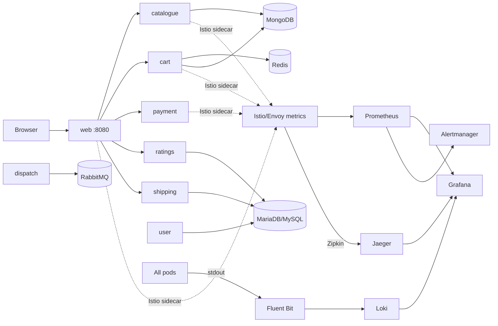

# Capstone 2 — Robot Shop on Kubernetes

This directory contains the Capstone 2 deliverable: **Robot Shop** deployed on the
same kind cluster used for Capstone 1, with a full observability stack, SLOs,
alerts, a runbook, a dashboard as code and incident evidence.

The upstream chart is vendored from `instana/robot-shop` (`K8s/helm`) and
modified to remove Instana agent settings and to run on a single-node kind
cluster. The application images are the upstream `robotshop/rs-*` images.

## Architecture



The graded path is `web -> catalogue/cart/payment`. The other services are kept
running because Robot Shop expects them, but they are not part of the SLO.

## What is included

| Area | Artifact |
| --- | --- |
| Application chart | `capstone2/robot-shop` (Instana removed, MariaDB, kind values, load generator) |
| Cluster | kind `voting-capstone`, ports 8080/8081/8090 |
| Metrics | kube-prometheus-stack in `observability` |
| Dashboard | `capstone2/observability/dashboards/robot-shop.json` and `robot-shop-dashboard.yaml` |
| Alerts | `capstone2/observability/robot-shop-alerts.yaml` |
| Logs | Loki + Fluent Bit |
| Traces | Istio -> Jaeger (Zipkin ingestion); OTel Collector is installed for future app instrumentation |
| SLO | `capstone2/docs/SLO.md` |
| Error budget | `capstone2/docs/ERROR_BUDGET_POLICY.md` |
| Runbook | `capstone2/docs/RUNBOOK.md` |
| Postmortem | [`capstone2/docs/POSTMORTEM.md`](docs/POSTMORTEM.md) |
| Drill evidence | `../docs/evidence/capstone2/` - alert JSON, Prometheus/Grafana screenshots, Loki query, timestamps |

## Prerequisites

- Docker Desktop with at least 16 GB RAM (the chart's MySQL/MariaDB and RabbitMQ
  are memory-hungry on a single node).
- `kind`, `kubectl`, `helm` and `docker` on PATH.
- PowerShell 5.1 or PowerShell 7. The scripts are compatible with both; this
  machine uses:
  ```powershell
  powershell -NoProfile -ExecutionPolicy Bypass -File .\scripts\run-capstone2.ps1
  ```

## One-command bring-up

From the repository root:

```powershell
powershell -NoProfile -ExecutionPolicy Bypass -File .\scripts\run-capstone2.ps1
```

The script:

1. creates the kind cluster if it does not exist;
2. installs Istio base/control plane and enables sidecar injection;
3. deploys Robot Shop with `values-kind.yaml`;
4. installs kube-prometheus-stack, Loki, Fluent Bit, Jaeger and the OTel Collector;
5. applies the SLO alerts and the dashboard ConfigMap.

If the cluster already exists:

```powershell
powershell -NoProfile -ExecutionPolicy Bypass -File .\scripts\run-capstone2.ps1 -SkipKindCreate
```

To stop and delete everything:

```powershell
kind delete cluster --name voting-capstone
```

## Manual install (the commands the script runs)

```powershell
kind create cluster --name voting-capstone --config .\deploy\kind-config.yaml --wait 120s

helm repo add istio https://istio-release.storage.googleapis.com/charts
helm repo add prometheus-community https://prometheus-community.github.io/helm-charts
helm repo add grafana https://grafana.github.io/helm-charts
helm repo add fluent https://fluent.github.io/helm-charts
helm repo update

helm upgrade --install istio-base istio/base -n istio-system --create-namespace --wait
helm upgrade --install istiod istio/istiod -n istio-system -f .\capstone2\observability\istio-values.yaml --wait

kubectl create namespace robot-shop --dry-run=client -o yaml | kubectl apply -f -
kubectl label namespace robot-shop istio-injection=enabled --overwrite

helm upgrade --install robot-shop .\capstone2\robot-shop -n robot-shop `
  -f .\capstone2\robot-shop\values-kind.yaml --wait --timeout 20m

helm upgrade --install kube-prometheus-stack prometheus-community/kube-prometheus-stack `
  -n observability --create-namespace `
  -f .\capstone2\observability\kube-prometheus-stack-values.yaml --wait --timeout 15m

helm upgrade --install loki grafana/loki -n observability `
  -f .\capstone2\observability\loki-values.yaml --wait
helm upgrade --install fluent-bit fluent/fluent-bit -n observability `
  -f .\capstone2\observability\fluent-bit-values.yaml --wait

kubectl apply -f .\capstone2\observability\jaeger.yaml
kubectl apply -f .\capstone2\observability\otel-collector.yaml
kubectl apply -f .\capstone2\observability\telemetry.yaml
kubectl apply -f .\capstone2\observability\robot-shop-alerts.yaml
kubectl apply -f .\capstone2\observability\robot-shop-dashboard.yaml
```

## Access

Robot Shop is exposed through the kind NodePort mapping:

- Web UI: http://localhost:8090

Port-forward the observability UIs:

```powershell
kubectl -n observability port-forward svc/kube-prometheus-stack-grafana 3000:80
kubectl -n observability port-forward svc/kube-prometheus-stack-prometheus 9090:9090
kubectl -n observability port-forward svc/jaeger-query 16686:16686
```

- Grafana: http://localhost:3000 — local demo credentials `admin` / `admin`.
- Prometheus: http://localhost:9090
- Jaeger: http://localhost:16686
- Dashboard: **Robot Shop - Service Health** (UID `robot-shop-slo`).

The load generator (`load` deployment) runs continuously with 10 clients against
`http://web:8080/`, so the dashboard and traces have data immediately.

## Demo script

1. Open the Robot Shop web UI at http://localhost:8090 and click through
   catalogue, cart, and payment.
2. Open the Grafana dashboard. Point out:
   - request rate by service;
   - 5xx error ratio and p95 latency;
   - deployment readiness;
   - recent Loki error logs.
3. Open Jaeger, select `web.robot-shop`, open a trace and show the downstream
   `shipping`/`payment` spans.
4. Open Loki Explore and run:
   ```logql
   {namespace="robot-shop"} |= "error"
   ```
5. Show the alert rules:
   ```powershell
   kubectl -n observability get prometheusrule robot-shop-slo
   ```
6. Run the incident drill in `capstone2/docs/DRILL.md` and show the alert firing,
   then mitigate and recover.
7. Read the postmortem in `capstone2/docs/POSTMORTEM.md`.

## Alert drill

The drill is deliberately simple and reversible:

```powershell
kubectl -n robot-shop scale deploy/payment --replicas=0
```

After the alert fires (2–5 minutes), restore it:

```powershell
kubectl -n robot-shop scale deploy/payment --replicas=1
kubectl -n robot-shop rollout status deploy/payment --timeout=5m
```

See `capstone2/docs/DRILL.md` for the exact timeline and evidence commands.

### Drill result (2026-10-26)

`RobotShopServiceDown` fired for `payment` after the Deployment was scaled to
zero. The outage lasted 4m52s; the alert was observed firing after 3m26s; the
recovery command restored a Ready payment pod in 11 seconds, and the alert
cleared by 23:25:58 UTC. The blameless write-up and action items are in
[`docs/POSTMORTEM.md`](docs/POSTMORTEM.md); raw evidence is in
`../docs/evidence/capstone2/`.

## Limitations and deviations

- This is a **kind** cluster, not EKS. Terraform for EKS exists in
  `infra/terraform` and is validated, but applying it requires AWS credentials
  and a budget. The cluster-rebuild story is demonstrated locally with kind.
- The upstream Robot Shop chart is vendored rather than installed from a remote
  chart repository, so the Instana settings could be removed and the MariaDB
  workaround documented.
- The OTel Collector is installed and configured, but the Istio mesh traces use
  Istio's Zipkin provider because Envoy's OTel gRPC exporter in this version
  sent HTTP/1.1 to the gRPC receiver. The OTel path remains available for
  application-level instrumentation.
- Slack delivery needs a real `SLACK_WEBHOOK_URL`; the repo ships the
  Alertmanager route and a placeholder secret example.
- GitHub Actions and EKS require repository/AWS credentials that are not present
  on this machine. The workflow and Terraform are complete and validated; see
  the root `docs/EVIDENCE.md` for the exact external gaps.
