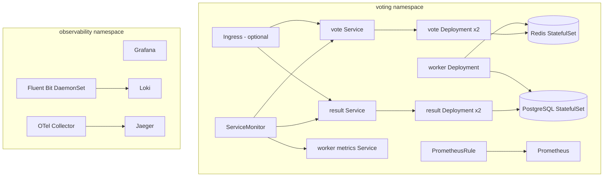

# Architecture

## System context

```mermaid
flowchart LR
    U[Voter / browser] -->|HTTP :8080| V[vote]
    U -->|HTTP :8081| R[result]

    V -->|RPUSH votes| Q[(Redis)]
    W[worker] -->|BLPOP votes| Q
    W -->|INSERT ... ON CONFLICT| P[(PostgreSQL)]
    R -->|SELECT count(*)| P

    P[/metrics] --- PR[Prometheus]
    V[/metrics] --- PR
    W[/metrics] --- PR
    PR --> G[Grafana]
    PR --> AM[Alertmanager] --> S[Slack]

    V -. OTLP .-> OC[OTel Collector] --> J[Jaeger]
    R -. OTLP .-> OC
    W -. OTLP .-> OC

    V -. stdout JSON .-> FB[Fluent Bit] --> L[(Loki)]
    R -. stdout JSON .-> FB
    W -. stdout JSON .-> FB
    L --> G
```

## Components

| Component | Responsibility | Scaling |
| --- | --- | --- |
| `vote` | Validate the ballot, generate a UUID, `RPUSH` JSON to Redis | Stateless; HPA on CPU |
| `worker` | `BLPOP` a vote, validate it, insert idempotently | Stateless; one or more replicas |
| `result` | Aggregate counts from PostgreSQL and serve JSON + HTML | Stateless; HPA on CPU |
| Redis | Durable-ish queue with AOF (`everysec`) | Single StatefulSet in this exercise |
| PostgreSQL | Source of truth, UUID primary key | Single StatefulSet in this exercise |
| Prometheus | Scrape metrics, evaluate alert rules | kube-prometheus-stack |
| Grafana | Dashboards and exploration | kube-prometheus-stack |
| Fluent Bit | Tail container logs, parse JSON, add Kubernetes labels | DaemonSet |
| Loki | Log storage and label index | Single binary for the exercise |
| OTel Collector | Receive OTLP and export traces to Jaeger | Stateless Deployment |
| Jaeger | Trace search and UI | In-memory all-in-one for the exercise |

## Vote write path

1. The browser `POST /vote` with `choice=cats|dogs`.
2. `vote` rejects anything else with HTTP 400.
3. It creates `{id, choice, created_at}` and `RPUSH`es it to `votes`.
4. The browser is redirected to `/?voted=cats` with HTTP 303.
5. The worker `BLPOP`s the message.
6. The worker inserts with `ON CONFLICT (id) DO NOTHING`.
7. If PostgreSQL is unavailable, the worker pushes the raw message back to the head of the queue and retries after two seconds.
8. Malformed messages are moved to `votes:dead` instead of blocking the queue.
9. `result` queries `SELECT choice, COUNT(*) FROM votes GROUP BY choice`.

The UUID makes retries idempotent. The queue is at-least-once: a crash after the DB commit but before removing the message cannot double-count because the primary key conflicts.

## Read path

`result` polls PostgreSQL every two seconds from the browser. It returns:

```json
{
  "total": 2,
  "choices": [
    {"id": "cats", "label": "Cats", "count": 1, "percent": 50.0},
    {"id": "dogs", "label": "Dogs", "count": 1, "percent": 50.0}
  ],
  "updated_at": "2026-10-26T19:00:00+00:00"
}
```

The result page renders the initial payload server-side, then polls `/api/results` with `cache: no-store`.

## Kubernetes topology



## Reliability decisions

- **Readiness vs liveness**: readiness checks dependencies (`/readyz`), liveness only checks the process (`/healthz`). A Redis outage removes vote pods from service instead of restarting them.
- **Rolling updates**: `maxUnavailable: 0`, `maxSurge: 1`; Helm `--wait` and `--atomic` in CI.
- **Resource limits**: every container has requests and limits; HPA uses CPU.
- **Graceful worker shutdown**: SIGTERM sets a stop flag; the current message finishes and the loop exits.
- **Observability**: structured JSON logs have stable `service`, `level`, and optional `trace_id`/`span_id`. Metrics use low-cardinality labels (`service`, `route`, `status`).
- **Secure defaults**: non-root, read-only root filesystem, dropped capabilities, no service-account token automount, Secret references instead of values.

## Failure modes

| Failure | User impact | Detection | Mitigation |
| --- | --- | --- | --- |
| Redis down | Vote page returns 503; result still works | `VotingAppPodDown`? Redis has no exporter; vote `/readyz` fails and vote logs errors | Restore Redis; vote recovers automatically |
| PostgreSQL down | Result shows degraded; worker retries queue | `result_db_up=0`, 5xx rate, worker logs | Restore PostgreSQL; worker drains queue |
| Worker down | Votes accumulate in Redis; result stale | `VotingFreshnessAtRisk` (age > 60s), `VotingQueueBacklog`, `VotingWorkerStalled` | Scale worker up; check logs/traces |
| Bad app release | 5xx or CrashLoopBackOff | 5xx alert, Helm failure, rollout status | `helm rollback`, automatic `--atomic` |
| Redis queue loss | Votes lost before processing | Queue depth drop, missing votes | Restore from AOF; document durability limit |
| High load | p95 latency increases | Latency alert, HPA | HPA scales vote/result; worker scales slower |

## Threat model (exercise scope)

- No authentication: this is a public demo. Add OIDC and per-user rate limiting for real elections.
- Redis has no password inside the cluster; NetworkPolicy limits access. Production would use TLS/auth or a managed service.
- PostgreSQL is internal-only; credentials live in a Kubernetes Secret. Production would use External Secrets and a managed database.
- Ingress is optional and not enabled by default. Use TLS when enabling it.

See [SLO.md](SLO.md), [RUNBOOK.md](RUNBOOK.md), and [DEMO.md](DEMO.md).
